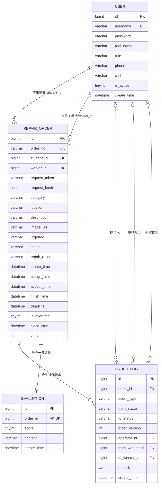
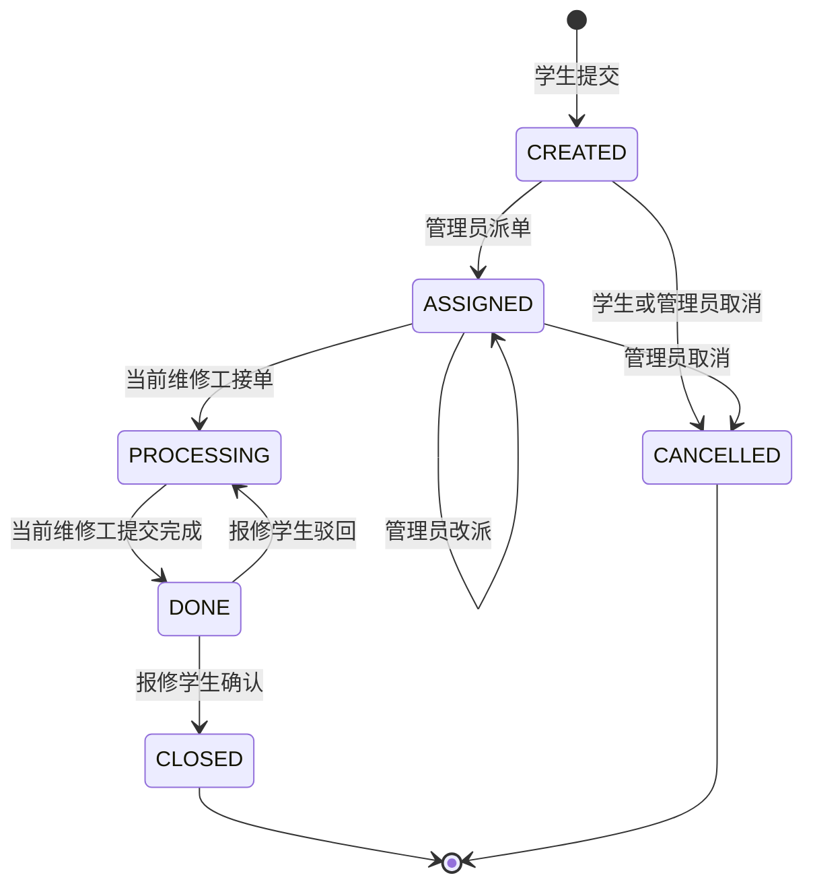
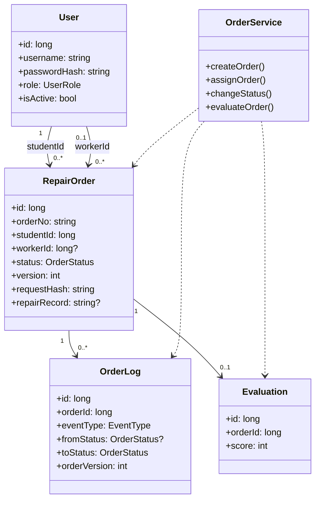
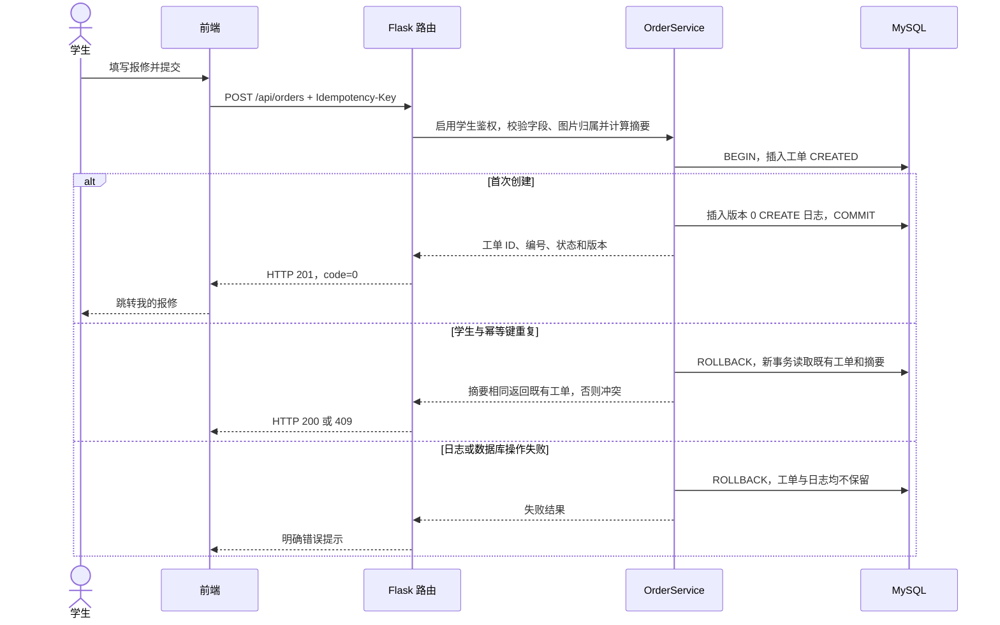
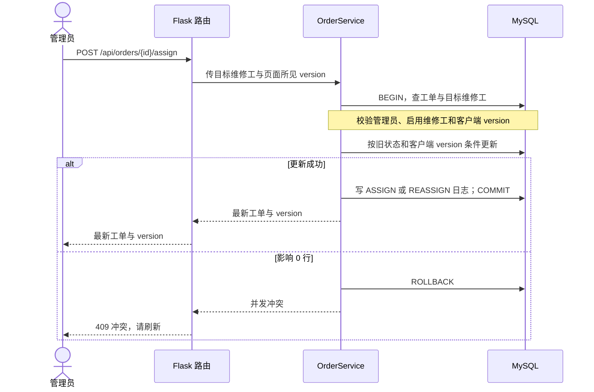
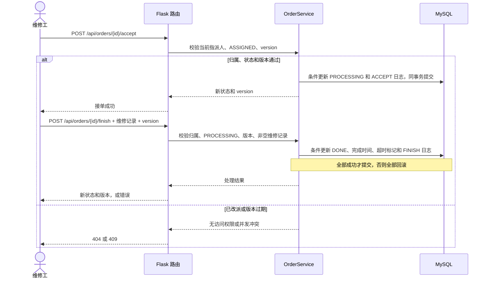
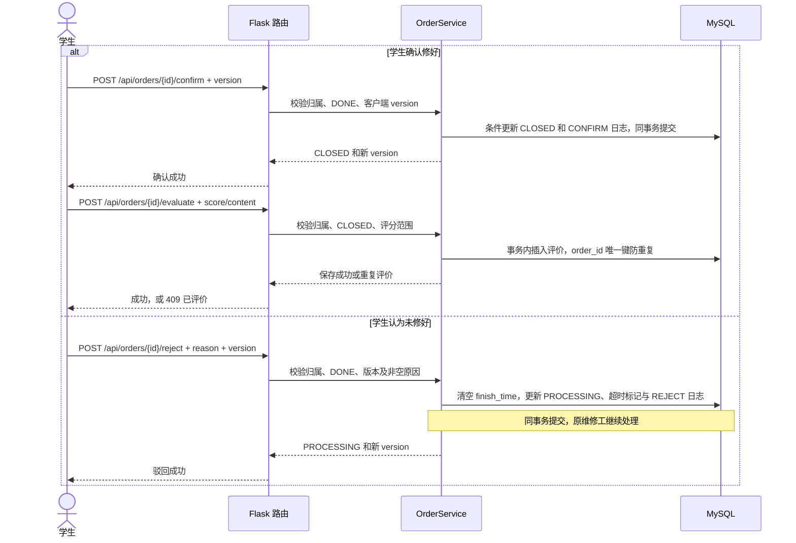

# 校园线上报修与后勤服务系统 A2 设计稿

版本：A2 修订稿 0.2，2026-10-12。面向技术实现组和测试组，以需求规格说明书 V1.0 为基线。新增字段与实施规则属于 A2 设计建议，未声称原需求文件已被批准修改。具体算法见 [实施细则](implementation-notes.md)，全部需求覆盖见 [追踪与验收](acceptance.md)。

## 1 需求边界与角色

学生提交、查看、取消本人报修，确认或驳回维修结果，关闭后评价。管理员查看待派单列表、派单或改派、查看评价与统计、处理超时预警。维修工查看分配给自己的工单、接单、记录维修结果并提交完成。系统提供登录、后端角色权限校验和操作流水。范围内只做站内提示与规则评分推荐，不接入短信、邮件或机器学习（原说明书 2.4、3.1）。

读取详情、日志、关联评价都校验工单归属：学生仅可读本人提交的工单，维修工仅可读当前 `worker_id` 为本人的工单，管理员可读全部。改派后原维修工失去该工单访问权限。停用账号不能登录或继续使用已有 token。以上是本稿统一采用的权限设计。

架构为浏览器 → Flask 路由 → `order_service` 业务模块 → `db.py` 数据访问层 → MySQL。实体类用于表达数据结构，不强制使用 ORM；PyMySQL 参数化 SQL 仍符合原说明书技术栈。Vue、Element Plus、Axios 等前端资源须随项目本地保存，避免说明书中的 CDN 示例与“不依赖外网”要求冲突。

## 2 E-R 图与关系

`worker_id` 在未派单时为空；`evaluation.order_id` 唯一，实现“每单最多一条评价”。外键只保证 ID 存在，`student_id` 的角色必须是 `STUDENT`、`worker_id` 必须是已启用的 `WORKER` 等跨表规则由业务层在事务内检查。

## 3 数据字典与关键约束

### user

| 字段 | 类型 | 规则和用途 |
| --- | --- | --- |
| id | BIGINT | 自增主键。 |
| username | VARCHAR(50) | 必填，唯一登录名。 |
| password | VARCHAR(255) | 必填，密码哈希；扩大到 255 为算法升级预留空间，演示数据使用 PBKDF2。 |
| real_name | VARCHAR(50) | 必填，展示姓名。 |
| role | VARCHAR(20) | 必填，仅 `STUDENT`、`WORKER`、`ADMIN`。 |
| phone | VARCHAR(20) | 可空，联系电话。 |
| skill | VARCHAR(100) | 可空，维修工技能标签；课程项目暂用逗号分隔。 |
| is_active | TINYINT | 补充设计；1 启用，0 停用。派单候选只显示启用维修工。 |
| create_time | DATETIME | 创建时间，默认当前时间。 |

### repair_order

| 字段 | 类型 | 规则和用途 |
| --- | --- | --- |
| id | BIGINT | 自增主键，内部关联用。 |
| order_no | VARCHAR(32) | 必填且唯一，应用层生成供用户查询的编号。 |
| student_id | BIGINT | 必填，指向报修学生。 |
| worker_id | BIGINT | 可空，当前指派的维修工；改派时更新。 |
| request_token | VARCHAR(64) | 补充设计；单次提交唯一键，和 `student_id` 联合唯一。 |
| request_hash | CHAR(64) | 补充设计；标准化创建请求的 SHA-256，用于判断同一幂等键是否被不同请求内容复用。 |
| category | VARCHAR(20) | 必填，故障类型；允许值待需求组冻结。 |
| location | VARCHAR(100) | 必填，故障地点。 |
| description | VARCHAR(500) | 必填，故障描述。 |
| image_url | VARCHAR(255) | 可空，已验证并保存的图片相对地址。 |
| urgency | VARCHAR(10) | `HIGH`、`NORMAL`、`LOW`；默认 `NORMAL`。 |
| status | VARCHAR(20) | 六种状态之一，默认 `CREATED`。 |
| repair_record | VARCHAR(500) | 补充设计；维修工最近一次提交的记录，历史内容同时留在日志备注。 |
| create_time | DATETIME | 提交时间。 |
| assign_time | DATETIME | 最近一次派单或改派时间。 |
| accept_time | DATETIME | 最近一次接单时间；改派时清空。 |
| finish_time | DATETIME | 本轮提交完成时间；驳回时清空，之前每次完成时间保留在 FINISH 日志中。 |
| deadline | DATETIME | 处理时限；何时设定及具体时长待评审。 |
| is_overtime | TINYINT | 是否曾超过处理时限，0/1；超时后保持 1。 |
| close_time | DATETIME | 学生确认关闭时间；取消不记为完成关闭。 |
| version | INT | 从 0 起，每次工单行更新递增，包括首次超时标记；与日志 `order_version` 对应。 |

### order_log

| 字段 | 类型 | 规则和用途 |
| --- | --- | --- |
| id | BIGINT | 自增主键，作为同秒日志的稳定排序键。 |
| order_id | BIGINT | 必填，关联工单。 |
| event_type | VARCHAR(20) | 补充设计；`CREATE`、`ASSIGN`、`REASSIGN`、`ACCEPT`、`FINISH`、`CONFIRM`、`REJECT`、`CANCEL`、`OVERTIME`。 |
| from_status | VARCHAR(20) | 创建事件为空；改派时为 `ASSIGNED`。 |
| to_status | VARCHAR(20) | 事件后状态；改派时仍为 `ASSIGNED`。 |
| order_version | INT | 补充设计；操作后的工单版本，和 `order_id` 联合唯一，创建为 0。 |
| operator_id | BIGINT | 人工事件必须记录操作人；系统 `OVERTIME` 事件为空。 |
| from_worker_id | BIGINT | 补充设计；改派前维修工。 |
| to_worker_id | BIGINT | 补充设计；派单或改派后的维修工。 |
| remark | VARCHAR(500) | 维修记录、驳回原因或操作备注。 |
| create_time | DATETIME | 操作时间。 |

### evaluation

| 字段 | 类型 | 规则和用途 |
| --- | --- | --- |
| id | BIGINT | 自增主键。 |
| order_id | BIGINT | 必填且唯一，关联已关闭工单。 |
| score | TINYINT | 必填，数据库约束为 1 至 5。 |
| content | VARCHAR(300) | 可空，评价文字。 |
| create_time | DATETIME | 评价时间。 |

## 4 工单状态机

| 事件 | 当前状态 | 操作人 | 下一状态 | 其他原子更新 |
| --- | --- | --- | --- | --- |
| CREATE | 无 | 学生 | CREATED | 生成编号和幂等键，写创建日志。 |
| ASSIGN | CREATED | 管理员 | ASSIGNED | 校验目标维修工启用，写 `worker_id`、`assign_time`、日志。 |
| REASSIGN | ASSIGNED | 管理员 | ASSIGNED | 目标不能等于原维修工；更新 `worker_id`、`assign_time`，清空 `accept_time`，日志记前后维修工。 |
| ACCEPT | ASSIGNED | 当前维修工 | PROCESSING | 写 `accept_time` 和日志。 |
| FINISH | PROCESSING | 当前维修工 | DONE | 维修记录非空；写 `repair_record`、`finish_time`，日志保存本次记录。 |
| CONFIRM | DONE | 报修学生 | CLOSED | 写 `close_time` 和日志。 |
| REJECT | DONE | 报修学生 | PROCESSING | 驳回原因非空；清空 `finish_time`，保留维修记录供追溯，日志保存原因。 |
| CANCEL | CREATED | 报修学生或管理员 | CANCELLED | 原因可选；以本次取消时间结算是否曾超时，写日志。 |
| CANCEL | ASSIGNED | 管理员 | CANCELLED | 原因可选；以本次取消时间结算是否曾超时，写日志。 |

`OVERTIME` 是系统对首次超时标志的更新事件，状态不变，不增加第七种工单状态。扫描任务仅在 0 → 1 时递增版本并写一次日志；业务动作自身发现超时，则在该动作的同一版本、同一日志中注明。

状态码与中文名称：`CREATED` 待派单，`ASSIGNED` 已派单，`PROCESSING` 维修中，`DONE` 待确认，`CLOSED` 已完成，`CANCELLED` 已取消。其余状态跳转全部拒绝。管理员在已派单状态取消，以及学生在未派单状态取消，均依据说明书 5.3.2。用户角色、工单归属、字段校验和合法迁移必须同时满足，不能仅凭目标状态在 `ALLOWED` 列表中就执行。

前端传来的 `version` 是并发校验依据。服务端事务内读到工单后，先检查它与客户端版本相同，不能用刚读到的新版本替换客户端旧版本。再用 PyMySQL 条件更新：`UPDATE repair_order SET ..., version=version+1 WHERE id=%s AND status=%s AND version=%s`，末尾参数使用客户端版本。影响行数必须为 1，随后写含新版本的日志，最后提交；任一步失败全部回滚。`REASSIGN` 状态不变，同样依靠版本检查。`CREATE` 将工单和版本 0 创建日志一起提交。评价仅新增评价行，不修改工单版本；在事务内校验 `CLOSED` 与学生归属，唯一键防重复。

图片上传限制 2 MiB（2,097,152 字节），服务端校验实际格式与安全路径。`request_token` 由前端为一次提交生成，同一次请求重试保留该值；唯一键冲突后必须先回滚，再在新事务读取既有工单并比较 `request_hash`，避免 MySQL 默认隔离级别的旧快照看不到并发提交的工单。摘要相同返回既有 ID，不同返回 409。

## 5 类图

图中的 `OrderService` 对应实际 `order_service.py` 模块，其 `change_status(conn, order_id, expected_version, event, actor, payload)` 是所有已有工单变更的统一入口，包括改派和系统超时事件；`create_order`、`evaluate_order` 负责创建和评价各自的事务。路由只鉴权、解析参数与映射响应，数据访问层不单独提交事务。

## 6 四个核心时序

### 学生提交报修

### 管理员派单或改派

### 维修工接单与提交完成

### 学生确认并评价

驳回与确认互斥，均要求页面携带最新 `version`。驳回后返回 `PROCESSING`，原维修工继续处理；如需改派已进入维修中的工单，应另立需求，当前状态机不支持。

## 7 超时与统计口径

原说明书没有给出具体 SLA。本稿采用待评审方案：创建时按紧急程度写入固定 `deadline`，以维修工提交完成为终点；改派和驳回不重新计时，待确认期间暂不累计超时，驳回后重新用当前时间与原期限比较。`is_overtime` 表示曾超时，`isCurrentlyOverdue` 是当前仍需处理且已逾期的派生值，两者不能混用。业务动作发生时与扫描任务都结算超时，覆盖“完成发生在两次扫描之间”的情况。完整判定表见实施细则。

统计明确区分提交量和完成量：提交量按 `create_time`、完成量按 `close_time`，时间范围左闭右开。维修工完成量和评分归属于工单最终 `worker_id`；当前状态机不允许维修中改派。各维修工平均分为其已评价工单评分的算术平均，未评价工单不计 0 分，无评价返回 `null`。
